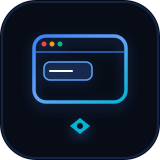

<p align="center">
  
</p>

<h1 align="center">Web2API</h1>

<p align="center">
  <strong>Use Active Browser AI Chat Sessions (ChatGPT, Claude, Gemini) as a Local OpenAI-Compatible REST API</strong>
</p>

<p align="center">
  
  
  
  
  
</p>

---

Web2API is a small browser extension (Chrome and Firefox) plus a tiny local program (the *bridge*).
Your tools talk to the bridge exactly as they would talk to OpenAI; the extension relays each request
to ChatGPT, Claude, Gemini and other chat sites **in your own browser, with your own login**. No
cookies are copied, no passwords are shared, nothing leaves your computer except what the chat site
itself receives.

```
 your tool / SDK ──HTTP──► bridge (127.0.0.1:8787) ──WebSocket──► extension ──► chat site in your browser
   (sk-w2a-… key)            OpenAI-compatible API                 types the prompt, reads the answer
```

> **Status — read this first.** This repository currently contains the **design specification**
> (`spec/`) and these user guides, which describe Web2API v1.0 *as designed*. The product is being
> built following `spec/10-implementation-plan.md`. Commands and screens in these docs will work once
> the matching phase is finished; until then treat them as the target behaviour. Each guide says which
> parts depend on later phases.

## Client SDKs & Libraries

Connect your applications directly to your standalone Web2API server with official client packages:

| Platform | SDK Package | Real-Time Streaming | Quickstart |
|---|---|---|---|
| **🤖 Android (Kotlin)** | [`sdks/android`](sdks/android/) ⭐ *(Top Priority)* | `Kotlin Flow<String>` | [Android Guide](sdks/android/README.md) |
| **🐍 Python** | [`sdks/python`](sdks/python/) | `Generator` & `AsyncGen` | [Python Guide](sdks/python/README.md) |
| **💙 Flutter / Dart** | [`sdks/flutter`](sdks/flutter/) | `Stream<String>` | [Flutter Guide](sdks/flutter/README.md) |
| **⚛️ React / Next.js / TS** | [`sdks/react`](sdks/react/) | `useWeb2ApiChat` Hook | [React Guide](sdks/react/README.md) |

👉 **[View the Master SDK Guide & Cross-Project Integration Documentation](sdks/README.md)**

## Independent Server Deployment

Web2API is completely self-contained and decoupled. You can run it on your local workstation, LAN, VPS, or cloud container:

* **Docker**: `docker compose up -d`
* **Python**: `python3 bridge_server.py`
* **Guide**: [Standalone Server Deployment & Security Guide](docs/standalone_server_guide.md)

## 🔐 Security model

* **Private by default.** The bridge listens on `127.0.0.1`. To expose it you must set `HOST`
  explicitly, and it **refuses to bind a network address unless an API key exists**.
* **Per-install keys.** `install.sh` (or `python3 web2api_keys.py generate`) writes random keys to
  `api.txt` with `chmod 600`. The file is git-ignored, so never commit it. Rotate with
  `python3 web2api_keys.py generate --force`.
* **Keys are enforced.** Once any key exists (`api.txt` or `WEB2API_API_KEY`), every API request needs
  `Authorization: Bearer <key>` (or `X-API-Key`), and the extension WebSocket needs `?token=<key>`, so
  a random web page can't impersonate the extension and read your prompts.
* **Old keys are revoked.** Keys once committed to this repository are rejected permanently. If you
  used them, regenerate.
* **Remote access:** prefer an SSH tunnel or a private network such as Tailscale. Avoid exposing the
  port to public Wi-Fi or the internet.

## Releases

| Version | What | Status |
|---|---|---|
| **1.0.0** | OpenAI-compatible API for ChatGPT, Claude, Gemini; Chrome + Firefox extension; bridge as Python package or standalone binary | planned (not released) |
| **2.0.0** | **MCP server**: chat, built-in web search, **Deep Research** tasks, and a free fast model for **commit messages, PR descriptions, README and docs** | planned (not released) |

See [`CHANGELOG.md`](CHANGELOG.md) and [`RELEASING.md`](RELEASING.md).

## Why you might want it

* Use a chat subscription you already pay for from editors, scripts and agents that speak the OpenAI API.
* One endpoint for several providers: model `claude`, `chatgpt`, `gemini`, … (more are planned).
* Lightweight: one Python dependency (`aiohttp`) or a single standalone binary; no headless browser, no
  second login, near-zero idle CPU.
* Private by design: loopback-only by default, per-install API keys enforced, no telemetry.
* **From v2.0.0, an MCP server** so assistants like Claude Code and Cursor can use the browser-only goodies —
  Deep Research, built-in web search, and a near-free Flash-Lite lane for chores — see [docs/mcp.md](docs/mcp.md).

## Important warnings

* **Terms of service.** Automating a consumer chat website may violate the provider's terms and can
  lead to rate limits, challenges, or account action. Use an account you can afford to lose and keep
  usage human-plausible. Web2API is not affiliated with OpenAI, Anthropic, Google or any provider.
* **Your browser must be open** and logged in to the providers you use. Web2API uses a dedicated
  worker window/tabs; it never types into the chat you are reading.
* **It is a web UI, not the real API.** Sampling parameters (temperature, max_tokens…) have no effect,
  token counts are estimates, tool calling and image input are not supported in v1.

## Quick start (about 5 minutes)

1. **Install the bridge** — pick one:
   * Binary (no Python): download for your OS from the Releases page and run it, or
   * Python: `uv tool install web2api-bridge` then `web2api-bridge`
   → [docs/install-bridge.md](docs/install-bridge.md)
2. **Install the extension** → [Chrome](docs/install-chrome.md) · [Firefox](docs/install-firefox.md)
3. **Pair them:** paste the bridge URL with your key (`ws://127.0.0.1:8000/ws?token=<key from api.txt>`) into the extension popup.
4. **Log in** to ChatGPT / Claude / Gemini in the same browser profile, and enable them in the popup.
5. **Call it:**
   ```bash
   curl http://127.0.0.1:8787/v1/chat/completions \
     -H "Authorization: Bearer $WEB2API_KEY" -H "Content-Type: application/json" \
     -d '{"model":"claude","messages":[{"role":"user","content":"Reply with exactly: PONG"}]}'
   ```
   → [docs/quickstart.md](docs/quickstart.md)

## Documentation

| Guide | |
|---|---|
| [Quick start](docs/quickstart.md) | From zero to a working call, with Python/JS/curl examples |
| [Install the bridge](docs/install-bridge.md) | Binary or Python, run at login (Linux, macOS, Windows) |
| [Install on Chrome](docs/install-chrome.md) | Chrome, Edge, Brave, other Chromium browsers |
| [Install on Firefox](docs/install-firefox.md) | Firefox and Firefox forks |
| [API keys](docs/api-keys.md) | Creating, scoping, rotating and revoking `sk-w2a-…` keys |
| [API reference](docs/api-reference.md) | Endpoints, parameters, streaming, errors |
| [Tool Calling & Functions](docs/tool_calling.md) | Standard OpenAI tool calling with resilient JSON/tag parser |
| [Using it with other tools](docs/compatibility.md) | Cursor, Continue, Open WebUI, LangChain, Aider, … |
| [MCP server (v2.0.0)](docs/mcp.md) | Use Web2API from Claude Code, Cursor, VS Code, Codex, … |
| [Deep Research and search (v2.0.0)](docs/research-and-search.md) | Cited answers and long research reports |
| [Developer chores (v2.0.0)](docs/dev-tools.md) | Commit messages, PR text, README/docs generation, git hook |
| [Providers](docs/providers.md) | What's supported, quirks, status |
| [Error codes](docs/errors.md) | What each error means and how to fix it |
| [Troubleshooting](docs/troubleshooting.md) | `doctor`, support bundle, common problems |
| [Privacy](docs/privacy.md) | What is stored, what is sent, how to wipe it |

For contributors and implementers: [`spec/00-README.md`](spec/00-README.md). Friend's reference project
that inspired the DOM techniques: `inspo/`. Superseded prototype: `archive/`.