# Far Future Architecture: Implementing ACP & Autonomous Browser-Backed Agents

> **Document Version:** 1.0.0  
> **Status:** Architecture Blueprint & Implementation Specification  
> **Target Subsystems:** Agent Client Protocol (ACP), ReAct Agent Loop, Structured Reasoning Engine, Firefox Web2API Pro Inference Backend.

---

## Table of Contents

1. [Executive Summary & Vision](#1-executive-summary--vision)
2. [What is the Agent Client Protocol (ACP)?](#2-what-is-the-agent-client-protocol-acp)
3. [System Architecture Diagram](#3-system-architecture-diagram)
4. [ACP Protocol Specification & Wire Format](#4-acp-protocol-specification--wire-format)
5. [The Autonomous Agent Loop (ReAct over Web Chat)](#5-the-autonomous-agent-loop-react-over-web-chat)
   - 5.1 System Prompt & Scratchpad Engineering
   - 5.2 Structured Tool-Call Extraction (Regex & Tiny ONNX)
   - 5.3 Observation Injection & State Continuity
6. [Context Management & Infinite Session Memory](#6-context-management--infinite-session-memory)
7. [Reference Implementation Blueprint (`acp_agent.py`)](#7-reference-implementation-blueprint-acp_agentpy)
8. [Edge AI Acceleration: Tiny ONNX / WebLLM Intent Parser](#8-edge-ai-acceleration-tiny-onnx--webllm-intent-parser)
9. [Self-Healing & Anti-Hallucination Guardrails](#9-self-healing--anti-hallucination-guardrails)
10. [Milestone Roadmap to Autonomous Operations](#10-milestone-roadmap-to-autonomous-operations)

---

## 1. Executive Summary & Vision

The combination of our **Firefox Web2API Extension** with the **Agent Client Protocol (ACP)** unleashes a new paradigm: **Zero-Cost Pro-Grade Autonomous Coding Agents**.

Instead of paying high per-token cloud API rates or struggling with local small models with weak reasoning, we harness the pro-level frontier intelligence of Google Gemini directly through an authenticated Firefox browser session. By wrapping this inference bridge in the open **Agent Client Protocol (ACP)**, any ACP-compatible client (such as IDEs, terminal coding agents, CLI tools, or code editors) can interact with an autonomous agent powered entirely by your browser.

```
┌────────────────────────────────────────────────────────┐
│               ACP Client (IDE / CLI / Editor)          │
└───────────────────────────┬────────────────────────────┘
                            │ JSON-RPC 2.0 (stdio/socket)
                            ▼
┌────────────────────────────────────────────────────────┐
│                 ACP Agent Host Server                  │
│   • Tool Registry (fs, terminal, git, search)          │
│   • ReAct Loop & Memory Compactor                      │
│   • Output Normalizer (Regex / Tiny ONNX)              │
└───────────────────────────┬────────────────────────────┘
                            │ REST / WebSocket
                            ▼
┌────────────────────────────────────────────────────────┐
│            Web2API Firefox Extension Bridge            │
│   • Background WebSocket Listener (ws://127.0.0.1:8000)│
│   • Real Profile Cookies & Authentication              │
│   • Deep Code & Markdown Extraction                    │
└───────────────────────────┬────────────────────────────┘
                            │ DOM Mutation & Synthetic Input
                            ▼
┌────────────────────────────────────────────────────────┐
│          gemini.google.com (Frontier LLM)              │
└────────────────────────────────────────────────────────┘
```

---

## 2. What is the Agent Client Protocol (ACP)?

The **Agent Client Protocol (ACP)** is an open, standardized communication protocol designed for bidirectional interaction between **Clients** (IDEs, text editors, CLI hosts) and **Agents** (AI coding assistants, autonomous executors).

### Key Responsibilities:
- **Client Capabilities**: The client provides the agent with access to the user's workspace:
  - File system operations (`read_file`, `write_file`, `list_directory`).
  - Terminal command execution with streamed stdout/stderr.
  - User authorization dialogs and permission management.
- **Agent Capabilities**: The agent accepts user prompts, maintains reasoning state, plans tasks, invokes client tools, and streams thoughts and code diffs back to the client.
- **Transport**: Standardized JSON-RPC 2.0 over standard I/O (`stdio`) or local WebSockets.

---

## 3. System Architecture Diagram

```mermaid
sequenceDiagram
    autonumber
    participant IDE as ACP Client (IDE / CLI)
    participant ACP as ACP Agent Server
    participant Bridge as Web2API Bridge (FastAPI)
    participant Ext as Firefox WebExtension
    participant Web as Gemini Web Chat (DOM)

    IDE->>ACP: initialize(clientCapabilities)
    ACP-->>IDE: initialized(agentCapabilities)
    IDE->>ACP: session/prompt("Refactor server.py to use async queues")
    
    rect rgb(20, 30, 50)
        Note over ACP,Web: ReAct Agent Step 1: Planning & Tool Call
        ACP->>Bridge: POST /v1/chat/completions (Prompt + Tool Schemas)
        Bridge->>Ext: WebSocket message (CHAT)
        Ext->>Web: Type prompt into contenteditable & click Send
        Web-->>Ext: Stream response tokens & code blocks
        Ext->>Ext: Clean DOM, parse code blocks & tool calls
        Ext-->>Bridge: Structured response with <tool_call>
        Bridge-->>ACP: JSON response with extracted tool calls
    end

    rect rgb(30, 40, 20)
        Note over ACP,IDE: Tool Execution Loop
        ACP->>IDE: fs/read_file("server.py")
        IDE-->>ACP: content: "..."
        ACP->>Bridge: POST /v1/chat/completions (Observation: file content)
        Bridge->>Ext: Forward observation
        Ext->>Web: Type observation into chat
        Web-->>Ext: Generated code patch
        Ext-->>Bridge: Parsed response
        Bridge-->>ACP: Return final solution
    end

    ACP->>IDE: fs/write_file("server.py", updated_code)
    ACP->>IDE: session/prompt reply (Task Complete)
```



---

## 4. ACP Protocol Specification & Wire Format

ACP uses standard JSON-RPC 2.0. Every message is either a **Request**, **Response**, or **Notification**.

### 4.1 Handshake (`initialize`)

**Client Request:**
```json
{
  "jsonrpc": "2.0",
  "id": 1,
  "method": "initialize",
  "params": {
    "protocolVersion": "2024-11-05",
    "clientInfo": {
      "name": "antigravity-client",
      "version": "1.2.0"
    },
    "capabilities": {
      "fs": {
        "readFile": true,
        "writeFile": true,
        "listDirectory": true
      },
      "terminal": {
        "runCommand": true,
        "streamOutput": true
      }
    }
  }
}
```

**Agent Response:**
```json
{
  "jsonrpc": "2.0",
  "id": 1,
  "result": {
    "protocolVersion": "2024-11-05",
    "agentInfo": {
      "name": "web2api-gemini-agent",
      "version": "1.0.0"
    },
    "capabilities": {
      "tools": true,
      "streaming": true,
      "sessions": true
    }
  }
}
```

### 4.2 Prompt Execution (`session/prompt`)

**Client Request:**
```json
{
  "jsonrpc": "2.0",
  "id": 2,
  "method": "session/prompt",
  "params": {
    "sessionId": "sess-8b7a1f",
    "prompt": "Run the test suite and fix any failing assertions in test_parser.py"
  }
}
```

---

## 5. The Autonomous Agent Loop (ReAct over Web Chat)

Because web chat models produce natural language, we structure the conversation using a strict **ReAct (Reasoning + Acting)** framework with synthetic tool signatures.

### 5.1 System Prompt Engineering

The agent prepends a system instruction to initialize the chat session:

```markdown
You are an autonomous AI software engineer communicating via the Agent Client Protocol (ACP).
You have access to the following local tools:

1. read_file(path: string) -> string
2. write_file(path: string, content: string) -> boolean
3. list_dir(path: string) -> string[]
4. run_command(command: string) -> { exit_code: int, stdout: string, stderr: string }
5. finish(summary: string) -> void

FORMAT INSTRUCTIONS:
To inspect or modify files or run commands, format your response EXACTLY as:
Thought: <Explain your step-by-step reasoning>
Action:
```tool_call
{
  "tool": "tool_name",
  "parameters": { ... }
}
```

Wait for the user or environment to provide the Observation before continuing.
When done, use the finish tool.
```

### 5.2 Structured Tool-Call Extraction (Regex & Tiny ONNX)

Our `parser.js` module in the Firefox extension automatically detects and parses tool blocks:

```javascript
// Regex tool-call detector from chat stream:
const toolCallRegex = /```(?:tool_call|json)?\s*(\{[\s\S]*?"tool"\s*:\s*"([a-zA-Z0-9_-]+)"[\s\S]*?\})\s*```/i;
```

If the chat model outputs natural language like:
> "I will now read the file `server.py` to check the endpoints."

Our secondary **Tiny ONNX intent classifier** or deterministic heuristic transforms this into:
```json
{
  "tool": "read_file",
  "parameters": { "path": "server.py" }
}
```

### 5.3 Observation Injection

When the client executes the tool, the agent formats the output and feeds it back into the browser chat:

```markdown
Observation:
[Command `pytest tests/` completed with exit code 1]
FAIL tests/test_parser.py::test_code_extraction
AssertionError: Expected 'python' but got 'text'
```

The model reads this observation in the next turn and generates the fix.

---

## 6. Context Management & Infinite Session Memory

Web chat interfaces typically have a maximum prompt length or degrade after many consecutive turns. To support long-running autonomous workflows:

### 6.1 Sliding Window Compaction
- **Active Window**: Keep the last 6 turns (Thought, Action, Observation).
- **Summary Anchor**: When conversation turns exceed 10, prompt the chat model to produce a concise summary:
  `"Summarize all completed changes, current system state, and active bugs in 150 words."`
- **Thread Reset**: Send `POST /api/reset` via the bridge to start a clean thread in Gemini, then inject the Summary Anchor as turn 0!

---

## 7. Reference Implementation Blueprint (`acp_agent.py`)

Here is the complete ACP Agent server implementing the JSON-RPC protocol and delegating reasoning to the Web2API bridge:

```python
"""
acp_agent.py - Full Agent Client Protocol (ACP) Server
Connects IDE clients via stdio JSON-RPC to the Web2API Firefox bridge.
"""

import sys
import json
import asyncio
import httpx
from typing import Dict, Any

BRIDGE_URL = "http://127.0.0.1:8000/v1/chat/completions"

SYSTEM_PROMPT = """You are an autonomous ACP coding agent.
You solve software tasks using tools: read_file, write_file, run_command, list_dir, finish.
Always output:
Thought: <reasoning>
Action:
```json
{"tool": "name", "parameters": { ... }}
```
"""

class ACPAgentServer:
    def __init__(self):
        self.session_history: list = []
        self.client_capabilities: dict = {}

    async def send_json_rpc(self, payload: dict):
        line = json.dumps(payload) + "\n"
        sys.stdout.write(line)
        sys.stdout.flush()

    async def call_web2api(self, messages: list) -> str:
        async with httpx.AsyncClient(timeout=180.0) as client:
            resp = await client.post(
                BRIDGE_URL,
                json={"model": "gemini-pro", "messages": messages}
            )
            data = resp.json()
            return data["choices"][0]["message"]["content"]

    async def execute_tool(self, tool_name: str, params: dict) -> str:
        # Request tool execution through the ACP client
        req_id = f"tool-{asyncio.get_event_loop().time()}"
        call_msg = {
            "jsonrpc": "2.0",
            "id": req_id,
            "method": f"tools/{tool_name}",
            "params": params
        }
        await self.send_json_rpc(call_msg)
        # Wait for client response (stubbed for illustration)
        return f"[Executed {tool_name} successfully]"

    async def handle_prompt(self, user_prompt: str):
        self.session_history = [
            {"role": "system", "content": SYSTEM_PROMPT},
            {"role": "user", "content": user_prompt}
        ]

        max_turns = 15
        for turn in range(max_turns):
            assistant_reply = await self.call_web2api(self.session_history)
            self.session_history.append({"role": "assistant", "content": assistant_reply})

            # Check for tool call
            if "```json" in assistant_reply:
                start = assistant_reply.find("```json") + 7
                end = assistant_reply.find("```", start)
                raw_json = assistant_reply[start:end].strip()
                action = json.loads(raw_json)

                if action.get("tool") == "finish":
                    await self.send_json_rpc({
                        "jsonrpc": "2.0",
                        "method": "notifications/message",
                        "params": {"content": action.get("parameters", {}).get("summary", "Done!")}
                    })
                    break

                obs = await self.execute_tool(action["tool"], action.get("parameters", {}))
                self.session_history.append({
                    "role": "user",
                    "content": f"Observation:\n{obs}"
                })
            else:
                # Direct conversational response
                break

    async def run(self):
        loop = asyncio.get_event_loop()
        reader = asyncio.StreamReader()
        protocol = asyncio.StreamReaderProtocol(reader)
        await loop.connect_read_pipe(lambda: protocol, sys.stdin)

        while True:
            line = await reader.readline()
            if not line:
                break
            msg = json.loads(line.decode().strip())
            method = msg.get("method")
            msg_id = msg.get("id")

            if method == "initialize":
                self.client_capabilities = msg.get("params", {}).get("capabilities", {})
                await self.send_json_rpc({
                    "jsonrpc": "2.0",
                    "id": msg_id,
                    "result": {
                        "protocolVersion": "2024-11-05",
                        "agentInfo": {"name": "web2api-agent", "version": "1.0.0"}
                    }
                })
            elif method == "session/prompt":
                prompt = msg.get("params", {}).get("prompt", "")
                await self.handle_prompt(prompt)

if __name__ == "__main__":
    asyncio.run(ACPAgentServer().run())
```

---

## 8. Edge AI Acceleration: Tiny ONNX / WebLLM Intent Parser

To make structured output parsing instantaneous and eliminate regex brittle edge-cases:

1. **Tiny ONNX Embedding/Classifier (`onnxruntime-web`)**:
   - Embeds a 22MB ONNX model (such as `bge-micro-v2` or `smol-router`) directly in the Firefox extension background page.
   - When the web chat returns ambiguous text, the ONNX model classifies the sentence into intent slots (`TOOL_CALL`, `CODE_PATCH`, `EXPLANATION`).
2. **Deterministic JSON Repair**:
   - Automatically repairs unclosed JSON brackets, escapes raw quotes, and validates against JSONSchema before passing the payload to the ACP server.

---

## 9. Self-Healing & Anti-Hallucination Guardrails

1. **Verification Pass**: Before any file modification or git commit, the agent runs syntax check (`python -m py_compile`, `cargo check`, or `tsc --noEmit`).
2. **Traceback Feedback Loop**: If an action throws an unhandled exception or non-zero exit code, the raw traceback is formatted as an Observation. The model automatically enters diagnostic mode.
3. **Loop Detection**: If the agent issues the identical tool call 3 times in a row with identical parameters, the engine interrupts:
   `"Warning: Detected repetitive loop. Step back, re-evaluate assumptions, and try an alternative strategy."`

---

## 10. Milestone Roadmap to Autonomous Operations

| Phase | Objective | Deliverables |
|:---|:---|:---|
| **Phase 1 (Complete)** | **Firefox Extension Core** | Extension loads in Firefox, parses code blocks cleanly, and connects to bridge server via WebSocket. |
| **Phase 2 (Active)** | **OpenAI REST Bridge** | FastAPI bridge server (`bridge_server.py`) with `/v1/chat/completions` and OpenAI schema compliance. |
| **Phase 3 (Next)** | **ACP Protocol Implementation** | `acp_agent.py` implementing stdio JSON-RPC 2.0 with tool execution loop (`read_file`, `write_file`, `run_command`). |
| **Phase 4** | **Browser Multimodal Support** | Adding image attachment support via Firefox content script to send screenshots to Gemini for visual debugging. |
| **Phase 5** | **Multi-Agent Swarms** | Orchestrating multiple background tabs (e.g. Gemini 1.5 Pro for architecture + Gemini Flash for fast linting/tests). |

---
*Authored for the Web2API Project. Designed to bridge free web-tier computing with frontier autonomous software engineering.*
